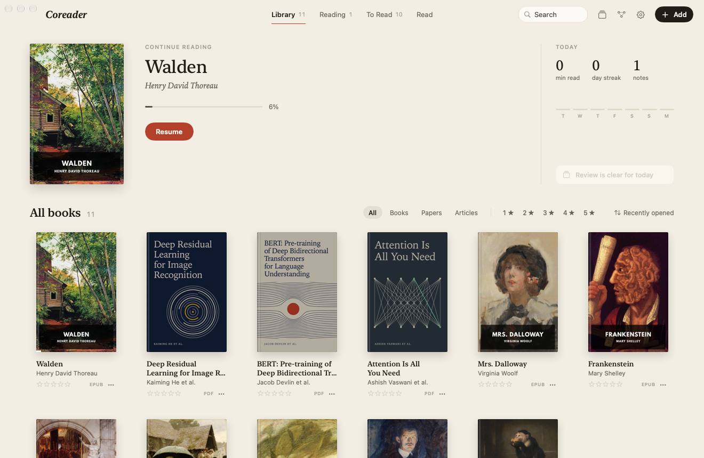
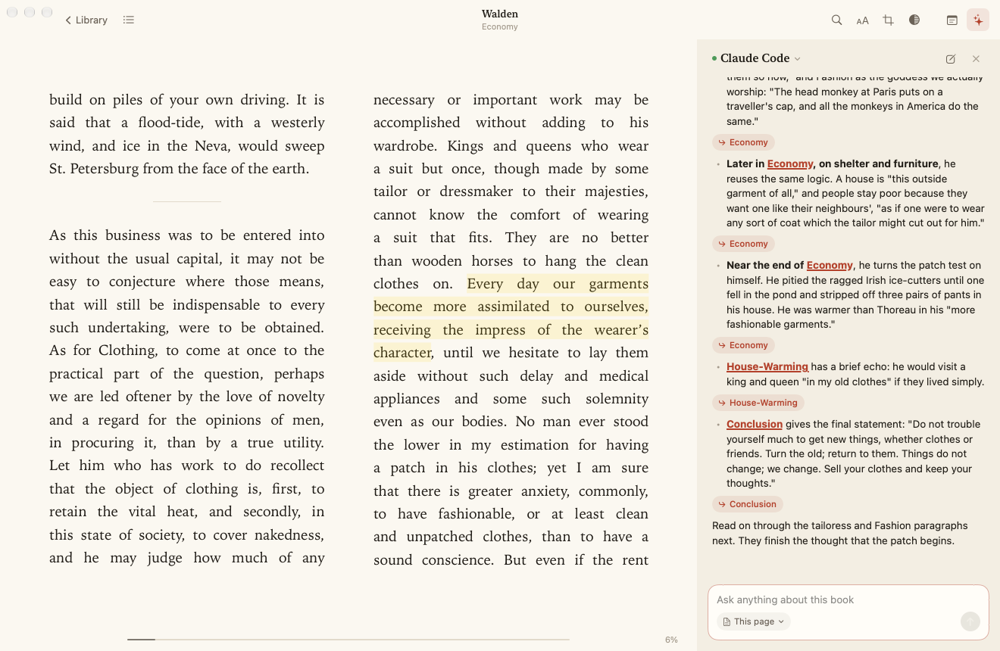

# Coreader

A reading app for Mac. Books, papers and saved articles sit on one shelf, your highlights
and notes are plain Markdown files you own, and the AI side panel runs on the agent apps
already installed on your Mac (Claude Code, Codex, Antigravity). There are no API keys to
paste and no account to create.

**[Download the latest version](https://github.com/sushilk1991/co-reader/releases/latest)**
(macOS 15 or later, Apple silicon and Intel, signed and notarized)





## What it does

- **One shelf for everything.** EPUB, PDF, MOBI, AZW3 and web articles. Sort into To Read,
  Reading and Read, rate with stars, filter and search. Papers and plain PDFs get a drawn
  cover, and a designed one if your agent can make images.
- **A calm reader.** Pages or scrolling, four themes, type and spacing controls, contents,
  search, focus mode. PDFs take the same themes as books.
- **Notes that are yours.** Highlight in five colours, write notes, keep a figure or snip
  any part of a page. Everything goes into one `notes.md` beside the book, with links that
  open the exact passage again.
- **Ask about what you are reading.** Ask about a selection, the page, the whole book or
  your notes. Answers point to places in the book as buttons that take you there. Explain,
  Look Up and Translate sit next to the selection. Presets: summarize, recap so far, teach
  me this book, quiz me.
- **Papers.** Add by arXiv id or DOI and the title, authors and abstract are looked up.
  Click a citation to see the cited paper and add it.
- **Remembering.** A few highlights come back each day for review, a graph shows the ideas
  your books share, and the shelf tracks reading time and streak.
- **Open to your agents.** A `coreader` command and an agent skill let any agent search
  and use your notes ("write a post from my notes on attention"). A book can be distilled
  into a skill of its own.

## Install

1. Download the `.dmg` from [Releases](https://github.com/sushilk1991/co-reader/releases/latest).
2. Drag Coreader to Applications and open it.

Later versions install from inside the app: it checks once a day, or use
**Coreader > Check for Updates…**.

The AI features need at least one of [Claude Code](https://claude.com/claude-code), Codex
or Antigravity installed and signed in. Coreader finds them by itself; reading,
highlighting and notes work without any of them.

## Your library is a folder

By default `iCloud Drive/Coreader` (you can change it in Settings), with one folder per book:

```
Books/<book>/
  book.json     shelf, rating, progress
  notes.md      highlights, notes and saved images: the only copy
  <book>.epub   the book itself
  cover.jpg
  assets/       snips and saved figures
```

There is no database behind it. Open `notes.md` in Obsidian or any editor, sync the folder
however you like, and point other tools at it. A highlight looks like this:

```markdown
## Economy

> Every day our garments become more assimilated to ourselves, receiving the impress of
> the wearer's character

[Economy](coreader://open?book=48f7ee77-…&a=098a5e29b935)
```

## For agents and the command line

The app bundles a `coreader` command (Settings installs it on your PATH):

```bash
coreader books --status reading      # what is on the go
coreader search "attention"          # every highlight, note and tag
coreader notes walden                # one book's notes
coreader text walden                 # the book's text
```

Most commands take `--json`. `integrations/skill/install.sh` links a skill into Claude
Code, Codex and Antigravity so they know how to use it.

Also in [`integrations/`](integrations):

- [`web-extension/`](integrations/web-extension): a Chrome, Arc, Brave and Edge extension
  that sends the page you are on to Coreader.
- [`mastisk/`](integrations/mastisk): a connector for the
  [Mastisk](https://github.com/sushilk1991/mastisk) knowledge wiki, which indexes the
  same Markdown files in place.

## Build from source

Needs macOS 15, Xcode and [`xcodegen`](https://github.com/yonaskolb/XcodeGen).

```bash
swift test                              # core library and CLI
xcodegen generate --spec project.yml
make build                              # the app (Debug)
make build-and-run-background           # launch without taking focus
```

| Read | For |
| --- | --- |
| [`AGENTS.md`](AGENTS.md) | Code layout, the on-disk library format, guardrails |
| [`docs/driving-the-app.md`](docs/driving-the-app.md) | Running and checking the app without a screen |
| [`docs/releasing.md`](docs/releasing.md) | Signing, notarizing and publishing a release |

The core (`Sources/CoreaderKit`) has no AppKit or SwiftUI in it, so an iOS and iPad app
can share it; that app is not built yet.

## Credits

EPUB, MOBI and AZW3 rendering uses [foliate-js](https://github.com/johnfactotum/foliate-js)
(MIT). The books in the screenshots are [Standard Ebooks](https://standardebooks.org)
editions.
